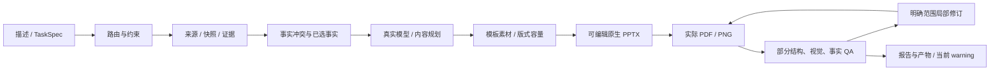

# YoloongPPT 当前实现与阶段收尾报告

日期：2026-10-12。按本次要求收尾已有来源工作包和基本全流程验证，本轮停止继续扩展工作包。原DOCX/XLSX的全部需求、任务、依赖、验收与GOV-009排除项继续保留。

**当前可以从一段描述生成可编辑PPTX，实际渲染、执行部分QA，再按明确范围局部修订并重新审查。系统处于可运行核心原型阶段，完整项目验收尚未完成。** 本次六页实物包含24个原生对象：22个文字对象、1个表格、1个图表。当前成稿仍为warning/final_allowed=false。

## 一、现在可以检查的成果

| 成果 | 实物 | 实际结果 |
| --- | --- | --- |
| 一段描述生成原稿 | [PPTX](validation/stage-closure-artifacts/description-generated/deck.pptx) / [PDF](validation/stage-closure-artifacts/description-generated/render/deck.pdf) | 实际DeepSeek事实解释、内容生成和独立审查，6页，P0=0、3警告 |
| 清除封面操作指令后的修订稿 | [当前PPTX](validation/stage-closure-artifacts/description-revised/deck.pptx) / [PDF](validation/stage-closure-artifacts/description-revised/render/deck.pdf) | 局部修改封面标题/正文，其他5页及数据保持；P0=0、2警告 |
| 两张工作表生成数据报告 | [PPTX](validation/stage-closure-artifacts/xlsx-generated/deck.pptx) / [PDF](validation/stage-closure-artifacts/xlsx-generated/render/deck.pdf) | 日期、千瓦时、百分比、公式缓存和分类数据进入六页表格/图表，P0=0、4警告 |
| 单段描述与任务 | [完整输入JSON](validation/stage-closure-artifacts/checks/description/description-task.json) | 只有一个prompt来源，没有另加Markdown材料；明确虚构软件验证数据 |
| 版本、模型、失败与QA | [实物SHA目录](validation/stage-closure-artifacts/evidence-manifest.json) | 保存当前实物、输入、决策/执行/QA/修订、旧失败和具体版本 |

最终流程15项检查通过；另8项直接核对PPTX中的分类、基线/本期系列名称与数值、表格单位、选定事实和ZIP差异。实际图表为基线[100,80,60]、本期[90,72,54]千瓦时，分类A楼/B楼/C楼。修改只涉及 `ppt/slides/slide1.xml`。见[流程检查](validation/stage-closure-artifacts/checks/description/description-flow-evidence.json)、[原生实物检查](validation/stage-closure-artifacts/checks/description/delivery-check.json)。



当前通过CLI、HTTP API、MCP和TaskSpec的描述字段调用。以下示例命令会实际调用模型：

```powershell
./scripts/project.ps1 start
Invoke-RestMethod http://127.0.0.1:8000/health
docker --context desktop-linux compose exec -T app python -m yoloongppt generate /workspace/validation/stage-closure-artifacts/checks/description/description-task.json
```

凭据保持在本机忽略的F盘秘密目录，JSON只引用环境变量名。健康入口可用，generation_ready=false表示完整验收未完成。

## 二、已经实现到什么程度

| 功能 | 当前可执行能力 | 尚未满足的范围 |
| --- | --- | --- |
| 入口与任务 | CLI/API/MCP共享核心，schema/ID/trace；持久任务、状态、取消、重试和显式恢复已有实测 | 全客户端、全部生命周期与任意节点调试 |
| 来源加载 | prompt/text/Markdown、DOCX、XLSX/CSV、PPTX/POTX、文本PDF、图片、JSON/XML有界解析，保存字节/结构/锚点 | HTML/URL、YAML、扫描OCR、复杂格式与完整语义 |
| 内容证据 | 来源分角色，冲突/缺失/假设与已选事实快照；未知硬约束、无依据数值/日期明确失败 | 抽取完整性、复杂跨源语义及事实真值 |
| 决策链 | DEC-001–040有界消费者/轨迹；首5节点按原矩阵验收已完成 | 其余35节点完整候选、语义、品牌、复杂对象与平台条件 |
| PPTX生成 | 真实模型规划，原生文字/图片/形状/连接线/表格/分类图表/备注；中文16:9与有界版式 | 全30对象、CRUD/效果/动画/媒体/高级属性与比例 |
| 模板素材 | 真实母版/layout/placeholder、模板策略与显式品牌锁；asset_id/hash/许可授权和1–8图布局 | 复杂模板图库映射、全部品牌属性、智能裁切与素材服务 |
| 内容容量 | 实际字体测量，完整正文/大表格分页，宽表声明关键列；硬预算不足时失败 | 任意模板、锁定版式、复杂语义拆合及全部极端内容 |
| 渲染QA | 实际LibreOffice/Poppler PDF/PNG；结构、几何、数值与部分视觉/事实/可访问性检查和真实复审 | 全规则、内容适用性、事实语义、可编辑性与兼容验收 |
| 修订 | 多页/多对象、唯一定位、锁保护、原生修改、未选parts保持、before/after/QA/history | 任意外来稿/section、全对象/裁切及全节点自动修订 |
| 工程安全 | Docker固定Python3.13.16/锁定依赖，项目数据F盘；路径/包/XML/大小/密钥有界防护 | 全安全/隐私/许可、性能并发、非功能及工程交付 |

主产品路线为PP-05 python-pptx 1.0.2，版本以镜像digest和requirements.lock为准。PP-01 PowerPoint16.0.20430.20092已独立COM打开、父稿副本另存/复开及前包四稿489项对照；Office保存会重写部分非目标部件，UI“无修复提示”尚未观察。本次新六页稿未再打开Office，AC-028未通过。PP-01–09完整研究与能力矩阵仍在范围。

## 三、未收尾短时工作包的处理结果

主包为TASK-IN-003/004/008/016、TASK-SYS-003，闭环关联SYS-015/016、QA-020、AC-001/002/003/005/027/030。助手已接入真实SourceLoader/事实解释及parser_version，实物、失败、原矩阵、报告、日志与版本统一收尾。原完整需求保持其原状态。

- DOCX：34项组件通过，保存heading/table逻辑grid/合并、真实图片hash/尺寸/alt、hyperlink/脚注/引用。有效URI有字面关系证据。物理页pending，不下载外链、不假称许可/OCR。当前完整生成因模型无依据变换日期而拒绝。[组件证据](validation/stage-closure-artifacts/components/docx/checks.json)。
- XLSX：57项组件通过，保存存储/格式/公式/缓存和日期、百分比、引用单位等有界投影，以及cell/range。未知地域/条件格式、缺缓存不冒作显示事实。真实两sheet生成12项链路通过；缓存新鲜与全Excel显示/语义未验收。[组件证据](validation/stage-closure-artifacts/components/xlsx/checks.json)。
- PDF：38项组件通过，真实四页文本/网格/图片清单、重复数字与字坐标保留；候选不是语义真值，不跨页拼接或虚构OCR/图片位置。实际六页输入模型输出截断，生成阻断。[组件证据](validation/stage-closure-artifacts/components/pdf/report.json)。

组件正常/边界夹具均明确为人工验证数据，模型调用为0，与真实AI生成检查分开保存。

## 四、发现并保留的限制

1. 硬四页请求至少需要六页可读容量，返回ADAPTIVE_PAGE_BUDGET_EXCEEDED，未删内容凑页数。[失败记录](validation/stage-closure-artifacts/checks/description/hard-four-page-failure/result.json)保留；后来使用明确不同的软六页请求。
2. 初稿封面写入制作指令/页数偏好，人工查看实际渲染才发现，自动QA没有拦截。明确局部修订后清除，其他页/数据不改。[人工问题记录](validation/stage-closure-artifacts/checks/description/manual-visual-issue.json)保存对象、P1、测量/阈值/动作与PNG hash。**自动内容适用性QA未完成。**
3. 当前DOCX返回FACT_DATE_TRANSFORM_UNAUTHORIZED；旧夹具还返回FACT_SCOPE_UNGROUNDED。解析检查通过不表示生成通过。[当前失败](validation/stage-closure-artifacts/checks/sources/docx-result.json)。
4. 当前PDF返回MODEL_OUTPUT_INCOMPLETE，截断响应未继续使用。[当前失败](validation/stage-closure-artifacts/checks/sources/pdf-result.json)。
5. XLSX成稿“月份+合计”同柱图，数字/单位已核对，表达合理性仍需完整语义审查；原空比例单元格可见标为“待确认”，原空值记录保留。数值相等不代表图表决策全通过。
6. 当前生成与修订仍有警告，DEC-040未允许final。全模型语义、对象/模式/后端与系统AC未因此完成。

## 五、还剩多少没有完成

以下按更新后的原矩阵验收结项统计。“进行中”包含可运行子能力、研究和缺验收项，不换算成可用功能百分比。

| 基线 | 已完成/通过 | 进行中/部分执行 | 未开始/未执行 | 尚未完成/通过 |
| --- | ---: | ---: | ---: | ---: |
| 308条主需求 | 35 | 174 | 99 | **273** |
| 453个任务 | 61 | 240 | 152 | **392** |
| 30个AC | 0通过 | 14部分执行 | 16未执行 | **30未通过** |

35条完成项包含2项治理、28项源码研究和DEC-001–005。45个S步骤仍为进行中；有界主链路可运行，全部模式/原完成条件未验收。逐项完成/剩余ID见[状态与ID清单](validation/stage-closure-status.json)。

| 需求域 | 完成 | 进行中 | 未开始 |
| --- | ---: | ---: | ---: |
| 治理与边界 | 2 | 8 | 0 |
| 开源源码研究 | 28 | 0 | 0 |
| 输入与来源 | 0 | 16 | 0 |
| 内容与证据 | 0 | 14 | 0 |
| 决策体系 | 5 | 35 | 0 |
| 模板/版式/风格 | 0 | 15 | 1 |
| 素材与视觉 | 0 | 10 | 6 |
| PPT原生对象 | 0 | 15 | 15 |
| PPT后端与接口 | 0 | 2 | 10 |
| 系统组件 | 0 | 21 | 1 |
| 已有PPT与修订 | 0 | 8 | 2 |
| 质量与验收 | 0 | 18 | 2 |
| 非功能 | 0 | 1 | 15 |
| 安全/隐私/许可 | 0 | 1 | 15 |
| 可观察性与复现 | 0 | 7 | 3 |
| 测试验收 | 0 | 3 | 17 |
| 工程交付 | 0 | 0 | 12 |

最影响基本使用可靠性的剩余工作：DOCX/PDF事实解释稳定性与完整性；指令泄漏等自动内容检查；复杂图表/模板/既有PPT语义和全部对象；模型/容量/恢复的完整产品验收；PowerPoint UI兼容与原AC。本轮登记这些缺口，不再新开包。

## 六、Excel、环境与版本

原XLSX本轮更新72个状态/证据单元格，同步需求/任务/AC/S步骤，修正S04/S05过时的“其他原始格式待实现”。20表/308/453、原ID/依赖/验收、完成状态、无关值/公式、特性数量及总览缓存核对通过，未增删任务。[矩阵守护报告](validation/stage-closure-matrix-update.json)。原完成标记保持，新增有界能力与失败写入对应证据/验收结果。

Docker代理曾连接内部引擎超时，重启Desktop并通过项目脚本恢复；实际WSL数据盘仍为F:\DockerDesktopWSL\disk\docker_data.vhdx，临时/运行/导出在F盘，未改变选型或重新安装产品依赖。

前一个修订包已提交并推送4547f3f。当前来源包、阶段实物、Excel、此报告及双日志统一中文提交并推送yoloongdevlop，最终SHA/同步以Git历史和收尾核验为准，不另写补SHA任务。阶段结论：核心闭环可运行，有限场景实物可检查，完整基线尚未交付。
